# **연산자**  
# **산술 연산자, 관계 연산자, 논리 연산자**  
기본적인 내용으로 이미지로 대체  
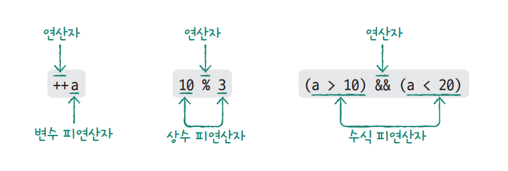  
  
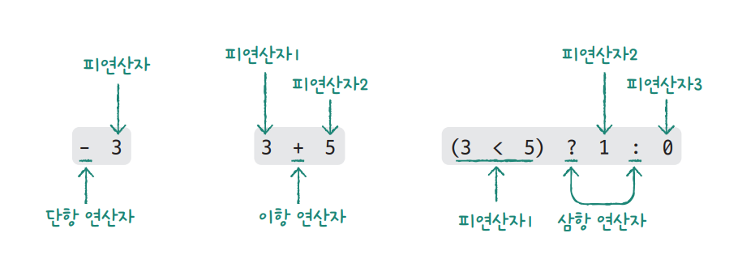  
  
# **산술 연산자와 대입 연산자**  
- 산술 연산자  
예제로 대체  
  
4-1 -> 4-1.c  
  
- 대입 연산자  
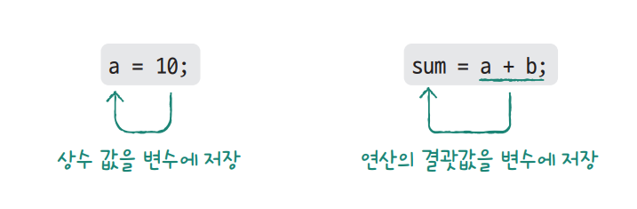  
  
- 나누기 연산자와 나머지 연산자  
예제로 대체  
  
4-1 -> 4-2.c  
  
# **증감 연산자**  
예제로 대체  
  
4-1 -> 4-3.c  
  
# **전위 표기와 후위 표기**  
예제로 대체  
  
4-1 -> 4-4.c  
  
# **관계 연산자**  
참 = 1, 거짓 = 0  
예제로 대체  
  
4-1 -> 4-5.c  
  
# **논리 연산자**  
예제로 대체  
  
4-1 -> 4-6.c  
  
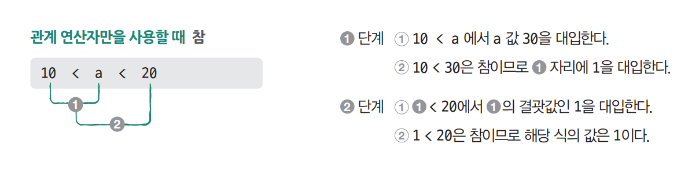  
  
# **숏 서킷 룰**  
&&는 좌항이 거짓이면 우항 연산을 안함  
||는 좌항이 참이면 우항 연산을 안함  
불필요한 연산을 줄여 실행 속도를 높임  
  
# **연산의 결괏값을 처리하는 방법**  
예제로 대체  
  
4-1 -> 4-7.c  
  
# **연산식이 컴퓨터 내부에서 처리되는 방식**  
수식 sum = a + b의 연산 과정을 나타내는 그림  
  
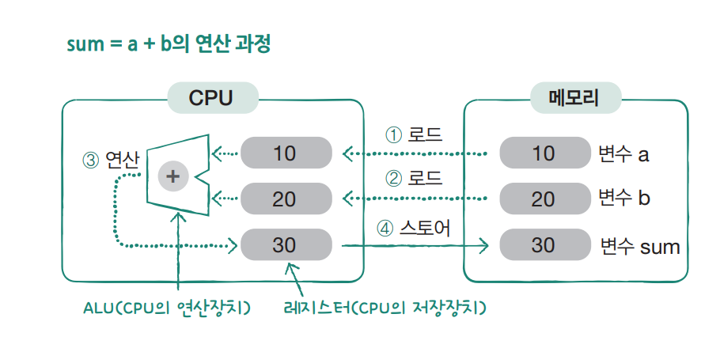  
  
연산을 하려면 메모리에 있는 a와 b의 값을 CPU의 저장 공간인 레지스터에 복사해야 한다. 이 과정을 로드(load)라고 하며 연산 명령 이전에 먼저 수행된다. 
데이터가 레지스터에 저장되면 연산장치인 ALU에 의해 덧셈 연산이 수행되고 그 결괏값은 일단 레지스터에 저장된다. 이후 대입 연산을 수행하면 메모리 공간인 
sum에 복사되어 수식의 모든 과정이 완료된다. 이 과정을 스토어(store)라고 한다. 연산할 때는 메모리에 있는 변수의 값을 CPU로 복사해서 사용하므로 
아무리 많은 연산을 수행해도 피연산자 a, b의 값은 변하지 않는다. 반면 대입 연산을 수행한 sum은 연산장치인 ALU에서 어떤 연산이 수행되느냐에 따라 값이 
변할 수 있다.  
  
# **CPU의 메모리와 RAM 메모리는 어떻게 다른가?**  
CPU의 메모리를 레지스터라고 하며 여기에 연산할 데이터와 연산 후의 결과를 임시 저장한다. 보통 레지스터는 CPU의 클럭과 1:1 동기화되어 있어 RAM에 비해 
엄청나게 빠르다. 따라서 실행 속도만 생각한다면 메모리보다 레지스터를 사용하는 편이 훨씬 유리하다. 다만 레지스터는 다음 연산을 위해 계속 사용되므로 
연산 결과를 메모리로 옮겨 놓지 않으면 그 값은 사라진다.  
  
# **그 외 유용한 연산자**  
# **형 변환 연산자**  
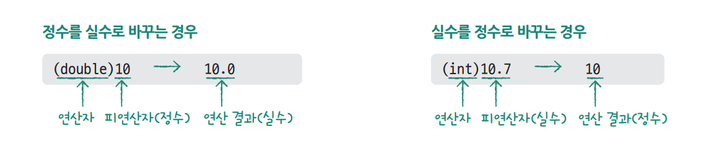  
  
4-1 -> 4-8.c  
  
# **자동 형 변환**  
자동 형 변환의 기본 규칙은 데이터 크기가 작은 값이 크기가 큰 값으로 바뀌는 것이다. 다만 대입 연산은 메모리에 값을 저장하므로 무조건 좌항의 변수형에 
맞게 저장된다.  
  
# **sizeof 연산자**  
sizeof 연산자는 피연산자를 하나만 사용할 수 있으며 피연산자의 크기를 바이트 단위로 계산해서 알려준다. sizeof(피연산자)로 표기하며 피연산자의 대상은 
변수, 상수, 수식, 자료형 등이 될 수 있다.  
  
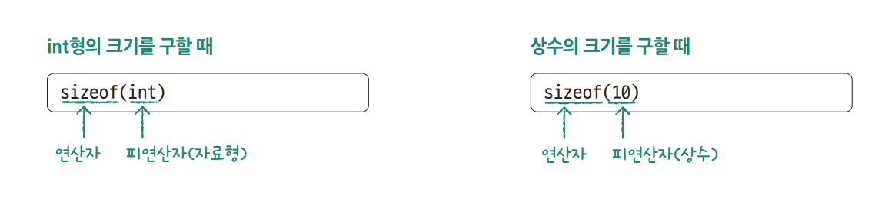  
  
이 연산자는 데이터의 크기를 확인하거나 메모리를 동적으로 할당하는 작업 등에 유용하게 사용된다.  
  
4-1 -> 4-9.c  
  
sizeof 연산자는 sizeof("A")처럼 문자열의 크기를 확인하는 데도 사용할 수 있다. 이때 문자열 끝에는 널 문자 \0이 삽입되므로 값은 2가 된다. 또한 
배열의 크기를 확인하는 용도로도 사용할 수 있다.  
  
- sizeof 연산자와 괄호  
sizeof는 연산자이므로 기본적으로 피연산자에 괄호를 사용할 필요가 없다. 하지만 아래와 같은 경우라면 다르다.  
  
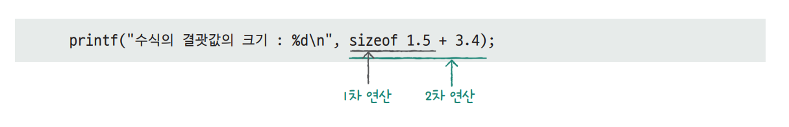  
  
sizeof 연산자는 1.5만 두고 계산해서 8을 계산한다. 그리고 거기에 3.4가 더해져 결괏값이 11.4가 된다.  
  
이런 차이를 일일이 기억하기 번거로우니 sizeof 연산자를 사용할 떄는 편의상 피연산자에 괄호를 사용하자.  
  
# **복합대입 연산자**  
4-1 -> 4-10.c  
  
# **콤마 연산자**  
한 번에 여러 개의 수식을 차례로 나열해야 할 때 사용한다. 콤마 연산자는 왼쪽부터 오른쪽으로 차례로 연산을 수행하며 가장 오른쪽의 피연산자가 최종 
결괏값이 된다.  
  
4-1 -> 4-11.c  
  
콤마 연산자는 대입 연산자보다 우선순위가 낮은 유일한 연산자이다. 따라서 대입 연산자와 함께 사용할 떄는 반드시 괄호가 필요하다.  
  
콤마 연산자는 제어문에서 조건식을 나열하는 괄호 안과 같이 세미콜론 사용이 불가능한 구조에서 사용한다. 예를 들어 for(i = 0, j = 10; i < j; i++)와 
같은 반복문에서 초깃값을 설정하는 두 문장(i = 0, j = 10)을 세미콜론으로 구분하면 for 문의 구문에 맞지 않아 에러가 발생한다.  
  
# **조건 연산자**  
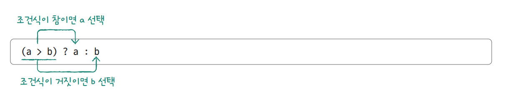  
  
4-1 -> 4-12.c  
  
조건 연산자의 피연산자에 대입식을 사용할 수 있지만 바람직한 사용법은 아니다. 조건 연산자는 코드를 간략히 만들어 주는 효과가 있으며 매크로 함수에 
사용하면 좋으나 가독성을 떨어뜨릴 가능성이 있다.  
  
# **비트 연산자**  
비트 연산자는 데이터를 비드 단위로 연산한다. 비트 연산자에는 논리 연산을 수행하는 &, |, ^ 같은 비트 논리 연산자와 비트를 좌우로 움직이는 >>, << 
같은 비트 이동 연산자가 있다. 비트 연산자는 데이터를 비트로 정확히 표현할 수 있는 정수에만 사용할 수 있다.  
  
4-1 -> 4-13.c  
  
- 비트별 논리곱 연산자  
printf("a & b : %d\n", a & b);  
  
2개의 피연산자 a와 b를 각각 비드별로 논리곱 연산을 한다.  
  
즉, 변수 a에 저장되어 있는 비트와 b에 저장되어 있는 비트의 각 위치별로 하나씩 피연산자로 생각하고 논리곱 연산을 수행한다. 0은 거짓이고 1은 참이다.  
  
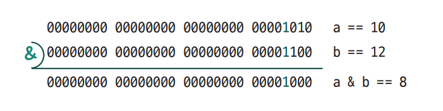  
  
- 비트별 배타적 논리합 연산자  
printf("a ^ b : %d\n", a ^ b);  
  
비트 단위로 배타적 논리합 연산을 수행한다.  
  
배타적 논리합의 진리값은 두 피연산자의 진리값이 서로 다를 때만 참이 된다. 즉, 둘 다 참이거나 둘 다 거짓이면 거짓이고, 하나는 참이고 다른 하나가 
거짓인 경우에 참이 된다.  
  
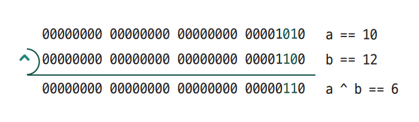  
  
- 비트별 논리합 연산자  
printf("a | b : %d\n", a | b);  
  
| 연산은 두 비트 중에서 하나라도 참이면 1로 계산한다.  
  
- 비트별 부정 연산자  
printf("~a : %d\n", ~a);  
  
피연산자가 하나이며 피연산자의 비트를 반전시킨다.  
  
- 비트 이동 연산자  
printf("a << 1 : %d\n", a << 1);  
printf("a >> 2 : %d\n", a >> 2);  
  
<<은 비트를 왼쪽으로 이동시키고 >>은 오른쪽으로 이동시킨다.  
  
이때 해당 방향으로 밀려나는 비트는 사라지고 남는 비트는 0으로 채워진다.  
  
# **연산자 우선순위와 연산 방향**  
- 단항 연산자 > 이항 연산자 > 삼항 연산자 순서로 연산된다.  
- 산술 연산자 > (비트 이동 연산자) > 관계 연산자 > 논리 연산자 순서로 연산된다.  
  
4-1 -> 4-14.c  
  
